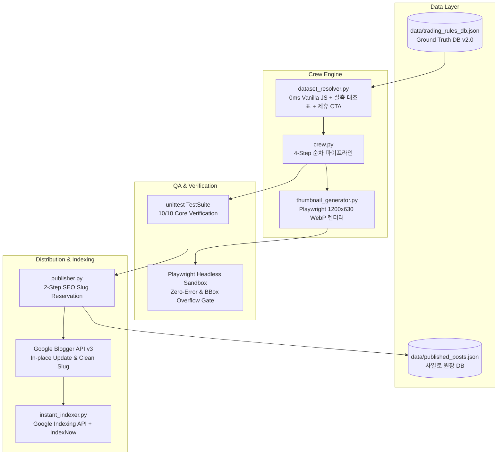

# Blogin 365 AI Holdings - Technical Architecture Specification

## 1. 개요 (Overview)
본 문서는 Antigravity 2.0 및 Gemini Flash (High Reasoning 모드) 기반으로 무인 자동화 운영되는 고수익 핀테크 Micro-SaaS 미디어 팩토리의 기술 아키텍처 명세서이다.

## 2. 4대 핵심 컴포넌트
1. **SSOT Ground Truth Data Layer (`data/trading_rules_db.json`)**:
   - 2026 소득세법, 조특법, 자본시장법 기반 세법 및 퀀트 공식 하드코딩 영구 배제.
   - 세율(22%, 15.4%, 9.9%), 공제액, 마진율 상수화.
2. **0ms 반응형 Micro-SaaS 엔진 (`dataset_resolver.py`)**:
   - 외부 의존성(React, Vue, CDN) 없는 순수 Vanilla JS Single-File 컴포넌트.
   - 데스크톱/모바일 반응형 슬라이더, 프리셋 버튼, 클립보드 복사.
3. **2-Step 영문 퍼머링크 슬러그 예약기 (`publisher.py`)**:
   - 1차: `english_slug`로 `insert()`하여 clean URL 영구 확보.
   - 2차: 0.5초 후 정식 한글 타이틀로 `update()`하여 제목 갱신.
4. **기계적 무인 품질 오라클 게이트 (`tests/`)**:
   - Playwright DOM Bounding Box 실측: 글자 잘림(`overflow: true`), 워터마크 충돌 0건 보장.
   - 단위 테스트 스위트 100% 통과 시에만 실발행 승인.
