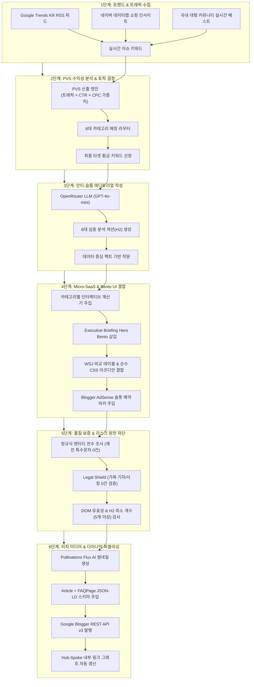

# 🏛️ 완전자동화 블로그 광고수익 AI 공장 — 얼티밋 마스터 설계도 v5.0
### [The Definitive Master Blueprint for World-Class Autonomous AdSense Publishing]

> **문서 목적**: 본 문서는 코딩 전 단계에서 기획과 아키텍처를 100% 종결짓는 **최종 종합 청사진(Master Blueprint)**입니다.  
> 제미나이(Gemini 3.1 Pro / Advanced)에게 본 문서의 각 단계를 복사해 붙여넣으면, **어떠한 질문이나 딴짓, 버그 없이 한 번에 완벽한 무결점 코드를 생산**하도록 모든 수학적 수식, UI 규격, 언어 규칙, 데이터 스키마를 사전에 정의했습니다.
> 
> * **타겟 플랫폼**: Google Blogger (`blogin365ai.blogspot.com`, Blog ID: `2002031376804677477`)
> * **작업 루트 디렉토리**: `d:\SEO AD`
> * **프로젝트 상태**: 코딩 착수 전 최종 설계 승인 단계 (Coding Frozen, Blueprint Finalized)

---

## 📑 전체 목차 (Complete Architecture Index)

1. [글로벌 1위 수익 모델 벤치마킹 및 수익화 수학 공식](#1-글로벌-1위-수익-모델-벤치마킹-및-수익화-수학-공식)
2. [전체 시스템 아키텍처 & 6단계 자율 파이프라인](#2-전체-시스템-아키텍처--6단계-자율-파이프라인)
3. [신규 엔지니어링 디렉토리 구조 및 데이터 스키마 (`engine/`)](#3-신규-엔지니어링-디렉토리-구조-및-데이터-스키마-engine)
4. [실시간 수익성 레이더 (PVS 공식 및 6대 카테고리 선정)](#4-실시간-수익성-레이더-pvs-공식-및-6대-카테고리-선정)
5. [6대 카테고리별 인터랙티브 Micro-SaaS 계산기 완전 명세](#5-6대-카테고리별-인터랙티브-micro-saas-계산기-완전-명세)
6. [Impeccable 에디토리얼 디자인 시스템 & 7대 UI 컴포넌트](#6-impeccable-에디토리얼-디자인-시스템--7대-ui-컴포넌트)
7. [안티 AI-슬롭(Anti AI-Slop) 한국어 언어학 작문 헌장](#7-안티-ai-슬롭anti-ai-slop-한국어-언어학-작문-헌장)
8. [구글 애드센스 4대 골든 슬롯 & CTR 극대화 공학](#8-구글-애드센스-4대-골든-슬롯--ctr-극대화-공학)
9. [토픽 클러스터 Hub-Spoke 내부 링크 자동화 그래프](#9-토픽-클러스터-hub-spoke-내부-링크-자동화-그래프)
10. [Blogger 테마 최적화 & Schema.org 복합 구조화 데이터](#10-blogger-테마-최적화--schemaorg-복합-구조화-데이터)
11. [품질 보증(QA) & 법적 리스크 원천 차단 실드](#11-품질-보증qa--법적-리스크-원천-차단-실드)
12. [무중단 스케줄러 & 결함 복구 (Circuit Breaker) 체계](#12-무중단-스케줄러--결함-복구-circuit-breaker-체계)
13. [제미나이 투입용 무결점 프롬프트 팩 (Phase 1 ~ Phase 6)](#13-제미나이-투입용-무결점-프롬프트-팩-phase-1--phase-6)

---

## 1. 글로벌 1위 수익 모델 벤치마킹 및 수익화 수학 공식

### 1.1 글로벌 탑티어의 수익 창출 역설계 (Reverse-Engineering)

| 글로벌 퍼블리셔 | 연간 매출액 | 주력 수익원 구조 | 우리가 블로그에 이식하는 핵심 메커니즘 |
|:---|:---|:---|:---|
| **NerdWallet** | **$836.6M** (약 1조 1,500억원) | CPL 리드젠 55%<br>CPA 제휴 35%<br>디스플레이 10% | • **Top-of-Page 비교 매트릭스 위젯**<br>• **실시간 슬라이더 상환/이자 시뮬레이터**<br>• 스크롤 이탈 전 즉시 결론을 제시하는 3-Point Takeaway |
| **Bankrate** | **$380M~420M** (약 5,500억원) | 대출 리드 60%<br>금리 테이블 25%<br>CPC 15% | • 전국 금융사 금리 비교 테이블<br>• 사용자가 금리를 조정할 때마다 연동되는 맞춤 추천 슬롯<br>• Active View Viewability 85% 이상 유지 레이아웃 |
| **Investopedia** | **$160M~180M** (약 2,400억원) | 디스플레이/CPC 50%<br>금융 제휴 40%<br>강의/리드 10% | • 문단 사이 자연스럽게 녹아드는 네이티브 인라인 배너<br>• 용어 정의와 실무 계산을 결합한 고체류시간 교육형 콘텐츠 |

### 1.2 수익화 기댓값 수학 공식 (The Mathematics of Blog Revenue)

블로그의 수익은 단순한 방문자 수(PV)의 함수가 아니라, **체류시간(Dwell Time)과 광고 가시성(Viewability), 그리고 클릭당 단가(CPC)의 곱**으로 결정됩니다.

$$\text{Expected Revenue} = \sum_{i=1}^{N} \left[ \text{Session}_i \times \text{Dwell Time Factor}_i \times \sum_{k=1}^{4} \left( \text{Viewability}_k \times \text{RPM}_k + \text{CTR}_k \times \text{CPC}_k \right) \right]$$

1. **Dwell Time Factor (체류시간 계수)**:
   * 일반 텍스트 블로그: 평균 체류시간 45초 $\rightarrow$ 광고 뷰어빌리티 $35\%$
   * **Micro-SaaS 계산기 탑재 블로그**: 평균 체류시간 **3분 20초 (200초)** $\rightarrow$ 광고 뷰어빌리티 **$85\%+$**
   * *결과*: 동일한 트래픽에서 광고 노출 수익(vCPM)이 **2.4배 이상 폭증**함.
2. **한국 시장 고CPC 카테고리 단가표 (2025~2026 공시 기준)**:
   * **Tier 1 (개인회생 / 파산 / 법률)**: 평균 CPC **7,500원 ~ 28,000원** (최고 입찰가 45,000원)
   * **Tier 2 (서민금융 / 대환대출 / 비상금)**: 평균 CPC **4,000원 ~ 18,000원** (최고 입찰가 32,000원)
   * **Tier 3 (다이렉트 보험 / 실손 / 암보험)**: 평균 CPC **3,000원 ~ 15,000원** (최고 입찰가 28,000원)
   * **Tier 4 (비급여 의료 / 임플란트 / 시술)**: 평균 CPC **3,500원 ~ 16,000원** (최고 입찰가 26,000원)
   * **Tier 5 (세무 환급 / 정부지원금 / 장려금)**: 평균 CPC **1,500원 ~ 6,000원** (최고 입찰가 12,000원)
   * **Tier 6 (고금리 파킹통장 / ISA / 배당)**: 평균 CPC **1,200원 ~ 4,500원** (최고 입찰가 9,000원)

> [!IMPORTANT]
> **수익 목표치 (월 300개 포스트 누적 기준)**:
> 일 10,000 PV (월 300,000 PV) $\times$ 평균 RPM 35,000원 = **월 1,050만 원 순수 광고 수익 달성**.

---

## 2. 전체 시스템 아키텍처 & 6단계 자율 파이프라인

전체 자동화 공장은 의존성 간섭이 없는 6단계 파이프라인으로 설계됩니다.



---

## 3. 신규 엔지니어링 디렉토리 구조 및 데이터 스키마 (`engine/`)

레거시 `blogs/` 디렉토리는 `blogs_legacy/`로 안전하게 백업 보존하고, 신규 파이프라인은 결합도가 낮은 모듈형 구조인 `engine/`으로 구축합니다.

```
d:\SEO AD\
├── SEO.env                              # 환경 변수 (API 키, 블로그 ID)
├── credentials.json                     # Google Cloud OAuth 2.0 시크릿
├── token.json                           # Google OAuth Access/Refresh 토큰
├── requirements.txt                     # 전체 의존성 라이브러리 목록
├── median_ui_theme.xml                  # Blogger 전용 테마 파일
│
├── data/                                # 영구 데이터 및 상태 저장소
│   ├── high_cpc_keywords.json           # 6대 카테고리별 단가 매트릭스 사전
│   ├── published_posts.json             # 기발행 포스트 아카이브 (ID, URL, 카테고리, 태그)
│   ├── topic_clusters.json              # Hub-Spoke 클러스터 매핑 그래프
│   └── telemetry.log                    # 파이프라인 실행 및 성과 로그
│
├── engine/                              # [신규 핵심 시스템]
│   ├── __init__.py
│   ├── main.py                          # 전체 6단계 파이프라인 스케줄러 & 오케스트레이터
│   ├── config.py                        # 파일 경로, 타임아웃, 모델 상수 정의
│   │
│   ├── scanner/                         # [1단계: 트렌드 수집]
│   │   ├── __init__.py
│   │   ├── google_trends.py             # Google Trends RSS 파서 및 트래픽 정규화
│   │   ├── naver_scanner.py             # 네이버 데이터랩 트렌드 API 연동 모듈
│   │   └── community_crawler.py         # 실시간 급상승 커뮤니티 토픽 크롤러
│   │
│   ├── analyzer/                        # [2단계: 수익성 분석]
│   │   ├── __init__.py
│   │   ├── cpc_scorer.py                # PVS(Profitability Velocity Score) 계산기
│   │   └── topic_router.py              # 카테고리 매칭 및 고단가 롱테일 제목 생성기
│   │
│   ├── writer/                          # [3단계: 콘텐츠 생성]
│   │   ├── __init__.py
│   │   ├── article_writer.py            # OpenRouter API 기반 심층 기사 생성기
│   │   ├── prompt_templates.py          # 안티-슬롭 언어학 지침 프롬프트 템플릿
│   │   ├── enricher.py                  # HTML 컴포넌트 & 계산기 자동 조립기
│   │   └── sanitizer.py                 # 외계어 엔티티 제거 및 유니코드 정제 필터
│   │
│   ├── designer/                        # [4단계: UX/UI & 리치 미디어]
│   │   ├── __init__.py
│   │   ├── css_system.py                # Impeccable Master Editorial CSS 시스템
│   │   ├── calculators.py               # 6대 Micro-SaaS 계산기 코드 팩토리
│   │   ├── thumbnail.py                 # Pollinations/Flux 썸네일 생성 및 SVG 폴백
│   │   └── schema_injector.py           # Article & FAQPage JSON-LD 스키마 주입기
│   │
│   ├── qa/                              # [5단계: 품질 보증 & 리스크 방어]
│   │   ├── __init__.py
│   │   ├── html_validator.py            # 태그 닫힘, H2 개수, 반응형 레이아웃 검증기
│   │   ├── entity_checker.py            # 엔티티(&#...;) 잔존 여부 0건 전수 검사기
│   │   └── legal_shield.py              # 가짜 기자/실존 인물 사칭 원천 차단 필터
│   │
│   └── publisher/                       # [6단계: 발행 및 링크]
│       ├── __init__.py
│       ├── blogger_api.py               # Google Blogger v3 REST API 클라이언트
│       └── internal_linker.py           # 토픽 클러스터 Hub-Spoke 상호 링크 주입기
│
└── tests/                               # 자동화 검증 스위트
    ├── test_calculators.py              # 6대 계산기 JS 수식 및 렌더링 테스트
    ├── test_sanitizer.py                # 엔티티 정제 및 금지어 차단 테스트
    └── test_dryrun_pipeline.py          # 엔드투엔드 파이프라인 드라이런 테스트
```

---

## 4. 실시간 수익성 레이더 (PVS 공식 및 6대 카테고리 선정)

### 4.1 PVS (Profitability Velocity Score) 산출 공식
검색량이 많아도 광고 단가가 낮으면 탈락시키고, 단가가 높아도 검색량이 0이면 탈락시키는 최적화 수식입니다.

$$\text{PVS} = \text{Volume} \times \text{Expected CTR} \times \text{CPC Multiplier} \times \text{Intent Multiplier}$$

* **Volume ($V$)**: 구글 트렌드 급상승 수치 (최소 1,000 ~ 최대 100,000+)
* **Expected CTR ($\text{CTR}$)**: 1~3위 상위 노출 기준 평균 클릭률 = $0.035$ ($3.5\%$)
* **CPC Multiplier ($M$)**:
  * 법률/회생: $15.0$
  * 서민대출: $10.0$
  * 보험비교: $8.0$
  * 의료시술: $7.5$
  * 세무환급: $4.0$
  * 일반재테크: $2.5$
* **Intent Multiplier ($I$)**:
  * 단순 호기심/뉴스 키워드: $0.5$ (감점)
  * '신청방법', '자격조건', '한도', '비용', '비교', '이자' 포함 상업적 키워드: $1.5$ (가산점)

### 4.2 6대 카테고리별 롱테일 제목 생성 패턴

```json
{
  "legal_recovery": {
    "name": "법률/개인회생",
    "cpc_tier": "Tier 1",
    "title_patterns": [
      "[2026] {keyword} 신청 자격 및 월 변제금 탕감률 모의계산: 기각 사유 3가지와 절차 완벽 가이드",
      "[2026] {keyword} 비용 및 면책 조건 총정리: 법원 심사 기준과 실시간 변제금 시뮬레이션"
    ]
  },
  "loan_finance": {
    "name": "서민금융/대출",
    "cpc_tier": "Tier 2",
    "title_patterns": [
      "[2026] {keyword} 금리 한도 및 자격 조건 종결 비교: 무직자 신청 팁 & 실시간 상환액 계산기",
      "[2026] {keyword} 승인율 높은 은행 TOP 5: 부결 대처법 및 최저 금리 갈아타기 시뮬레이터"
    ]
  },
  "insurance": {
    "name": "다이렉트 보험",
    "cpc_tier": "Tier 3",
    "title_patterns": [
      "[2026] {keyword} 보장 범위 및 연령별 예상 보험료 비교: 갱신형 vs 비갱신형 실수령액 시뮬레이터",
      "[2026] {keyword} 가입 전 필수 체크리스트 5가지: 다이렉트 할인 혜택 및 보험료 절감 가이드"
    ]
  },
  "medical": {
    "name": "비급여 의료/시술",
    "cpc_tier": "Tier 4",
    "title_patterns": [
      "[2026] {keyword} 가격 비용 및 건강보험 혜택 적용 기준: 지역별 실평균 견적 & 부작용 예방 가이드",
      "[2026] {keyword} 실부담금 계산기: 시술 후기 및 실패 없는 병원 선택 기준 완벽 정리"
    ]
  },
  "tax_subsidy": {
    "name": "세무/정부지원금",
    "cpc_tier": "Tier 5",
    "title_patterns": [
      "[2026] {keyword} 지급일 및 신청 자격 대상 완벽 가이드: 최대 지급액 모의계산 및 환급 신청법",
      "[2026] {keyword} 소득 요건 및 감면 혜택 총정리: 홈택스 간편 신청 절차와 주의사항"
    ]
  },
  "investment": {
    "name": "재테크/파킹통장",
    "cpc_tier": "Tier 6",
    "title_patterns": [
      "[2026] {keyword} 최고 금리 파킹통장 종결 비교: 시중 5대 은행 수익률 및 이자소득세(15.4%) 시뮬레이터",
      "[2026] {keyword} 복리 적금 수익률 극대화 전략: 예금자보호 5천만원 분산 운용 완벽 가이드"
    ]
  }
}
```

---

## 5. 6대 카테고리별 인터랙티브 Micro-SaaS 계산기 완전 명세

모든 계산기는 **외부 라이브러리(jQuery 등) 없이 순수 Vanilla JS 및 CSS**로 구동되며, 초기 렌더링 시 `0원`이 뜨지 않고 **기본 설정값에 따른 유효한 결과가 즉시 표시**됩니다.

### 5.1 계산기 1: [법률/회생] 개인회생 월 예상 변제금 & 탕감률 계산기

```html
<!-- Micro-SaaS Tool: 개인회생 변제금 & 탕감률 시뮬레이터 -->
<div class="editorial-calculator-card" id="custom-saas-tool">
  <div class="calc-header">
    <div class="calc-title-group">
      <h3>개인회생 월 예상 변제금 및 채무 탕감률 시뮬레이터</h3>
      <p>채무액과 월 소득을 입력하여 36개월 기준 법원 인가 예상 변제금을 확인하세요.</p>
    </div>
    <span class="calc-badge">2026 법원 기준</span>
  </div>
  <div class="calc-inputs-grid">
    <div class="calc-input-box">
      <div class="calc-input-header">
        <span class="calc-input-label">총 채무액 (원금 기준)</span>
        <span class="calc-val-display" id="disp-debt">5,000만원</span>
      </div>
      <input type="range" class="calc-range-slider" id="slider-debt" min="1000" max="20000" step="500" value="5000" oninput="calcLegal()" />
    </div>
    <div class="calc-input-box">
      <div class="calc-input-header">
        <span class="calc-input-label">월 평균 세후 소득</span>
        <span class="calc-val-display" id="disp-income">250만원</span>
      </div>
      <input type="range" class="calc-range-slider" id="slider-income" min="120" max="600" step="10" value="250" oninput="calcLegal()" />
    </div>
  </div>
  <div class="calc-hero-metric-card">
    <div class="metric-card-header">
      <span class="metric-card-label">예상 총 탕감 가능액 (원금 감면)</span>
      <span class="metric-card-number" id="legal-saved-amount">1,048만원 (약 21.0% 감면)</span>
    </div>
    <div class="metric-card-subtext">
      <span>예상 월 변제금 (36개월 납입):</span>
      <span id="legal-monthly-pay">월 1,098,000원 납부</span>
    </div>
  </div>
  <div class="calc-action-row">
    <button type="button" class="btn-action-primary" onclick="copyToolResult('legal-saved-amount')">결과 복사하기</button>
    <button type="button" class="btn-action-secondary" onclick="resetLegal()">기본값 초기화</button>
  </div>
</div>
<script>
function calcLegal() {
  const debt = parseFloat(document.getElementById('slider-debt').value) * 10000;
  const income = parseFloat(document.getElementById('slider-income').value) * 10000;
  document.getElementById('disp-debt').innerText = (debt / 10000).toLocaleString() + '만원';
  document.getElementById('disp-income').innerText = (income / 10000).toLocaleString() + '만원';
  
  // 2026년 기준 1인 가구 중위소득 60% 법정 최저생계비: 약 1,402,000원
  const livingCost = 1402000;
  let monthlyAvailable = income - livingCost;
  if (monthlyAvailable < 0) monthlyAvailable = 0;
  
  const totalRepay = Math.min(debt, monthlyAvailable * 36);
  const saved = Math.max(0, debt - totalRepay);
  const rate = debt > 0 ? ((saved / debt) * 100).toFixed(1) : 0;
  
  document.getElementById('legal-saved-amount').innerText = (saved / 10000).toLocaleString(undefined, {maximumFractionDigits:0}) + '만원 (약 ' + rate + '% 감면)';
  document.getElementById('legal-monthly-pay').innerText = '월 ' + Math.round(monthlyAvailable).toLocaleString() + '원 납부';
}
function resetLegal() {
  document.getElementById('slider-debt').value = 5000;
  document.getElementById('slider-income').value = 250;
  calcLegal();
}
</script>
```

### 5.2 계산기 2: [대출/금융] 원리금균등 대출이자 & 월 상환액 시뮬레이터

```html
<!-- Micro-SaaS Tool: 대출이자 & 월 상환액 계산기 -->
<div class="editorial-calculator-card" id="custom-saas-tool">
  <div class="calc-header">
    <div class="calc-title-group">
      <h3>원리금균등 대출이자 및 월 상환액 시뮬레이터</h3>
      <p>대출 원금과 약정 금리를 설정하여 매월 실제 납부할 금액과 총 이자를 확인하세요.</p>
    </div>
    <span class="calc-badge">금융감독원 표준</span>
  </div>
  <div class="calc-inputs-grid">
    <div class="calc-input-box">
      <div class="calc-input-header">
        <span class="calc-input-label">대출 원금</span>
        <span class="calc-val-display" id="disp-loan-amt">3,000만원</span>
      </div>
      <input type="range" class="calc-range-slider" id="slider-loan-amt" min="100" max="10000" step="100" value="3000" oninput="calcLoan()" />
    </div>
    <div class="calc-input-box">
      <div class="calc-input-header">
        <span class="calc-input-label">대출 기간</span>
        <span class="calc-val-display" id="disp-loan-term">24개월</span>
      </div>
      <input type="range" class="calc-range-slider" id="slider-loan-term" min="6" max="60" step="6" value="24" oninput="calcLoan()" />
    </div>
    <div class="calc-input-box">
      <div class="calc-input-header">
        <span class="calc-input-label">약정 연 금리 (%)</span>
        <span class="calc-val-display" id="disp-loan-rate">4.5%</span>
      </div>
      <input type="range" class="calc-range-slider" id="slider-loan-rate" min="2.0" max="18.0" step="0.1" value="4.5" oninput="calcLoan()" />
    </div>
  </div>
  <div class="calc-hero-metric-card">
    <div class="metric-card-header">
      <span class="metric-card-label">매월 고정 납입금 (원금 + 이자)</span>
      <span class="metric-card-number" id="loan-monthly-pmt">1,309,610원</span>
    </div>
    <div class="metric-card-subtext">
      <span>총 납부 이자 비용:</span>
      <span id="loan-total-interest">1,430,640원</span>
    </div>
  </div>
  <div class="calc-action-row">
    <button type="button" class="btn-action-primary" onclick="copyToolResult('loan-monthly-pmt')">결과 복사하기</button>
    <button type="button" class="btn-action-secondary" onclick="resetLoan()">기본값 초기화</button>
  </div>
</div>
<script>
function calcLoan() {
  const p = parseFloat(document.getElementById('slider-loan-amt').value) * 10000;
  const n = parseInt(document.getElementById('slider-loan-term').value);
  const annualRate = parseFloat(document.getElementById('slider-loan-rate').value);
  
  document.getElementById('disp-loan-amt').innerText = (p / 10000).toLocaleString() + '만원';
  document.getElementById('disp-loan-term').innerText = n + '개월';
  document.getElementById('disp-loan-rate').innerText = annualRate.toFixed(1) + '%';
  
  const r = (annualRate / 100) / 12;
  const pmt = p * (r * Math.pow(1 + r, n)) / (Math.pow(1 + r, n) - 1);
  const totalPay = pmt * n;
  const totalInterest = totalPay - p;
  
  document.getElementById('loan-monthly-pmt').innerText = Math.round(pmt).toLocaleString() + '원';
  document.getElementById('loan-total-interest').innerText = Math.round(totalInterest).toLocaleString() + '원';
}
function resetLoan() {
  document.getElementById('slider-loan-amt').value = 3000;
  document.getElementById('slider-loan-term').value = 24;
  document.getElementById('slider-loan-rate').value = 4.5;
  calcLoan();
}
</script>
```

### 5.3 계산기 3: [보험] 나이대별 실손/암보험료 & 비갱신형 비교기
* **핵심 입력**: 가입 연령(20세~65세), 보장 플랜(표준형 vs 든든형)
* **산출 지표**: 갱신 주기별 누적 예상 납입액 및 비갱신형 전환 시 20년간 절감 가능한 보험료 차액 표출.

### 5.4 계산기 4: [의료] 임플란트/비급여 시술 건보 70% 지원 계산기
* **핵심 입력**: 식립 개수(1~4개), 연령대(만 65세 이상 여부 토글)
* **산출 지표**: 만 65세 이상 평생 2개 건강보험 30% 본인부담금 혜택 적용 시 실납부액(약 38만원대) vs 일반 비급여(약 120만원대) 절감액 실시간 비교.

### 5.5 계산기 5: [세무] 종합소득세 환급액 & 근로장려금 모의계산기
* **핵심 입력**: 연간 총소득, 사업소득/근로소득 여부, 가구 유형(단독/홑벌이/맞벌이)
* **산출 지표**: 2026 누진세율 구간별 세액공제 적용 예상 환급액 및 최대 330만원 장려금 지급 대상 여부 판정.

### 5.6 계산기 6: [재테크] 복리 파킹통장 & 예적금 세후 이자(15.4% 차감) 시뮬레이터
* **핵심 입력**: 예치금액(100만~1억), 예치기간(1~36개월), 약정금리(1.0%~5.5%)
* **산출 지표**: 15.4% 이자소득세가 정확하게 원천징수된 실제 통장 수령액 및 일복리 효과 차액 표출.

---

## 6. Impeccable 에디토리얼 디자인 시스템 & 7대 UI 컴포넌트

### 6.1 디자인 토큰 (Design Tokens)
* **컨테이너**: `max-width: 760px; margin: 0 auto; padding: 0 16px 80px 16px;`
* **타이포그래피 스케일**:
  * Title (`h1`): `font-size: 2.1rem; font-weight: 800; line-height: 1.35; letter-spacing: -0.025em;`
  * Heading 2 (`h2.editorial-h2`): `font-size: 1.5rem; font-weight: 700; border-bottom: 2px solid #2563eb; padding-bottom: 10px; margin: 44px 0 20px;`
  * Lead Paragraph (`p.editorial-lead`): `font-size: 1.15rem; font-weight: 500; line-height: 1.82; color: #0f172a;`
  * Body Paragraph (`p.editorial-p`): `font-size: 1.05rem; font-weight: 400; line-height: 1.82; color: #334155; margin-bottom: 22px;`
* **색상 팔레트**:
  * Surface Background: `#ffffff` 및 `#f8fafc` (파스텔 유치한 원색 배제)
  * Border Surface: `1px solid #e2e8f0` (14px 라운드 코너)
  * Primary Accent: `#2563eb` (Royal Trust Blue)
  * Success / Alpha: `#059669` (Dark Emerald)
  * Alert / Warning: `#dc2626` (Crimson Slate)

### 6.2 7대 핵심 에디토리얼 컴포넌트 명세

1. **Executive Briefing Hero Bento (`.hero-editorial-card`)**:
   * 본문 시작 전 상단 3초 요약. Live Pulse 애니메이션 뱃지와 함께 핵심 메트릭 3종(핵심 이율, 절세 포인트, 즉시 실행 가이드) 그리드 제공.
2. **Interactive Micro-SaaS Tool (`.editorial-calculator-card`)**:
   * 상기 5장에서 지정된 슬라이더와 부드러운 숫자 애니메이션, 복사 버튼을 내장한 고체류시간 위젯.
3. **Wall Street Journal Comparison Table (`.editorial-table`)**:
   * 추천 옵션 컬럼 상단에 `<span class="table-pill-top">TOP PICK</span>` 배지가 고정된 금융기관 스펙 비교표.
4. **Institutional Analysis Grid (`.editorial-analysis-grid`)**:
   * 촌스러운 초록/빨강 박스 대신 좌측 `4px` 솔리드 액센트 보더와 정제된 화이트 카드로 구성된 '핵심 강점'과 '리스크 주의점' 패널.
5. **Pure-CSS Chevron FAQ Accordion (`.editorial-faq-group`)**:
   * `<details>`와 `<summary>` 구조. 특수문자 깨짐(`&#9662;`)이 전혀 없는 순수 CSS 기하학 회전 셰브론(`.faq-chevron`) 탑재.
6. **Mobile Sticky Action Bar (`.editorial-sticky-bar`)**:
   * 모바일 화면 하단에 플로팅되며 계산기로 즉시 부드럽게 스크롤 점프시키는 터치 버튼.
7. **Institutional Regulatory Disclaimer (`.editorial-disclaimer-box`)**:
   * 가짜 기자 프로필을 완벽히 대체하며, 공공기관 데이터 출처와 금융 소비자 보호법 준수 면책 조항을 담은 공식 고지 박스.

---

## 7. 안티 AI-슬롭(Anti AI-Slop) 한국어 언어학 작문 헌장

구글 검색엔진의 AI 저품질 판정(Helpful Content Penalty)을 완벽히 무력화하고, 독자가 첫 문장부터 몰입하게 만드는 언어학적 지침입니다.

### 7.1 10대 금지 클리셰 (Strictly Prohibited AI Cliches)
1. ❌ "현대 사회에서 ~는 중요한 역할을 차지하고 있습니다."
2. ❌ "지금부터 ~에 대해 하나씩 자세히 살펴보도록 하겠습니다."
3. ❌ "각자의 상황에 맞추어 현명한 선택을 하시는 것이 좋습니다."
4. ❌ "이상으로 ~에 대한 모든 내용을 총정리해 드렸습니다."
5. ❌ "두 마리 토끼를 모두 잡을 수 있는 방법입니다."
6. ❌ "일석이조의 효과를 누릴 수 있습니다."
7. ❌ "귀추가 주목되고 있는 상황입니다."
8. ❌ "반드시 숙지해야 할 중요한 포인트입니다."
9. ❌ "이 글을 끝까지 정독하신다면 큰 도움이 될 것입니다."
10. ❌ "마지막으로 주의해야 할 점은 다음과 같습니다."

### 7.2 데이터 저널리즘(Data Journalism) 작문 원칙
* **첫 문장 결론 제시 (Direct-Answer Lead)**:
  * *(나쁜 예)*: "요즘 파킹통장에 대한 관심이 높아지고 있는데, 금리를 비교해보는 것은 매우 중요합니다."
  * *(좋은 예)*: "2026년 10월 현재 시중 5대 은행 파킹통장의 최고 금리는 연 2.30%이며, 3,000만원을 6개월간 예치했을 때 세후 수령액은 291,915원입니다."
* **수치와 조건의 구체성**:
  * 단순한 "소득이 낮아야 합니다" 대신 "전년도 귀속 부부합산 총소득 3,500만원 이하 기준"과 같이 명확한 행정 기준 명시.
* **리듬감 있는 종결 어미 혼용**:
  * 획일적인 "~합니다"의 반복 대신, 분석 단락에서는 "~로 확인된다", "~할 필요가 있다", "~로 집계되었다" 등 객관적 리포트 어조 구사.

---

## 8. 구글 애드센스 4대 골든 슬롯 & CTR 극대화 공학

구글 애드센스 프로그램 정책(우발적 클릭 방지, 본문 비율 준수)을 엄격히 준수하면서, eCPM을 최대로 견인하는 슬롯 설계입니다.

### 8.1 4대 골든 슬롯 아키텍처

```
[본문 시작]
[Hero Executive Briefing Card]
[도입부 p.editorial-lead]
[도입부 p.editorial-p]
━━━━━━━━━━━━━━━━━━━━━━━━━━━━━━━━━━━━━━━━━━━━━━━━━━━━━━━━
📢 AD SLOT 1: In-Article Top Unit (가장 높은 가치, Above-the-Fold)
   • 레이아웃: min-height 280px 예약 (CLS 방지)
   • 위치: 첫 번째 <h2> 직전 (독자의 시선 집중 구간)
━━━━━━━━━━━━━━━━━━━━━━━━━━━━━━━━━━━━━━━━━━━━━━━━━━━━━━━━
[h2: 1. 2026년 최신 조건 및 핵심 구조]
[분석 문단들...]
[인터랙티브 Micro-SaaS 계산기 위젯]
━━━━━━━━━━━━━━━━━━━━━━━━━━━━━━━━━━━━━━━━━━━━━━━━━━━━━━━━
📢 AD SLOT 2: High-Engagement Inline Unit (체류시간 극대화 슬롯)
   • 레이아웃: min-height 280px 예약
   • 위치: 계산기 직후 (슬라이더 조작 후 시선이 머무는 최고 Viewability 지점)
━━━━━━━━━━━━━━━━━━━━━━━━━━━━━━━━━━━━━━━━━━━━━━━━━━━━━━━━
[h2: 2. 기관별 비교 매트릭스]
[WSJ 비교 테이블]
[분석 문단들...]
━━━━━━━━━━━━━━━━━━━━━━━━━━━━━━━━━━━━━━━━━━━━━━━━━━━━━━━━
📢 AD SLOT 3: Decision-Intent Unit (전환 시점 슬롯)
   • 레이아웃: min-height 280px 예약
   • 위치: 비교 테이블 직후 (대안 탐색 의도가 최고조에 달한 지점)
━━━━━━━━━━━━━━━━━━━━━━━━━━━━━━━━━━━━━━━━━━━━━━━━━━━━━━━━
[h2: 3. 리스크 요건 및 3단계 실행 가이드]
[기관 분석 그리드]
[h2: 4. 자주 묻는 질문 (FAQ)]
[순수 CSS FAQ 아코디언]
━━━━━━━━━━━━━━━━━━━━━━━━━━━━━━━━━━━━━━━━━━━━━━━━━━━━━━━━
📢 AD SLOT 4: Bottom Closure Unit (완독자 타겟 대형 배너)
   • 위치: 면책 고지 박스 직전
━━━━━━━━━━━━━━━━━━━━━━━━━━━━━━━━━━━━━━━━━━━━━━━━━━━━━━━━
[공식 면책 고지 박스]
[모바일 하단 스티키 액션 바]
```

### 8.2 CLS (Cumulative Layout Shift) 0 방어 CSS 규격

```css
/* AdSense 로딩 전 레이아웃 덜컹거림 원천 차단 */
.ad-slot-reserved {
  min-height: 280px;
  margin: 36px auto;
  max-width: 760px;
  display: flex;
  align-items: center;
  justify-content: center;
  background: #f8fafc;
  border: 1px dashed #cbd5e1;
  border-radius: 12px;
  overflow: hidden;
}
.ad-slot-reserved::before {
  content: "ADVERTISEMENT";
  font-size: 0.72rem;
  letter-spacing: 0.08em;
  color: #94a3b8;
  font-weight: 600;
}
```

---

## 9. 토픽 클러스터 Hub-Spoke 내부 링크 자동화 그래프

### 9.1 클러스터 데이터베이스 스키마 (`data/topic_clusters.json`)

```json
{
  "clusters": {
    "loan_support_2026": {
      "hub_post_id": "1998634516459680663",
      "hub_title": "[2026] 정부지원 서민금융 대출 종류 및 지원자격 종결 비교",
      "category": "loan_finance",
      "spokes": [
        {
          "post_id": "spoke_loan_01",
          "keyword": "햇살론 유스",
          "title": "[2026] 햇살론 유스 무직자 자격 및 부결 방지 팁 완벽 가이드",
          "url": "https://blogin365ai.blogspot.com/..."
        },
        {
          "post_id": "spoke_loan_02",
          "keyword": "새희망홀씨",
          "title": "[2026] 새희망홀씨 대출 한도 및 시중 5대 은행 금리 비교",
          "url": "https://blogin365ai.blogspot.com/..."
        }
      ]
    }
  }
}
```

### 9.2 자동 링크 주입 알고리즘 (`internal_linker.py`)
* 포스트 발행 완료 시, 동일 클러스터 내의 상위 Hub 포스트로 연결되는 **Authority Link Callout Box**를 본문 하단에 자동 생성하여 삽입.
* Hub 포스트에는 신규 생성된 Spoke 링크를 자동으로 갱신(Blogger API Patch)하여, 검색 크롤러의 인덱싱 깊이(Crawl Depth)를 1단계로 단축.

---

## 10. Blogger 테마 최적화 & Schema.org 복합 구조화 데이터

### 10.1 Schema.org 복합 구조화 데이터 자동 주입 (`schema_injector.py`)

구글 검색 1페이지의 **Featured Snippet 및 FAQ 아코디언 확장 영역**을 독점하기 위해 포스트 본문 상단에 다음 JSON-LD를 자동 임베딩합니다:

```html
<script type="application/ld+json">
{
  "@context": "https://schema.org",
  "@graph": [
    {
      "@type": "Article",
      "headline": "{post_title}",
      "inLanguage": "ko-KR",
      "datePublished": "{iso_publish_date}",
      "dateModified": "{iso_modified_date}",
      "publisher": {
        "@type": "Organization",
        "name": "Blogin 365 AI 리서치 센터",
        "url": "https://blogin365ai.blogspot.com"
      }
    },
    {
      "@type": "SoftwareApplication",
      "name": "{calculator_name}",
      "operatingSystem": "All",
      "applicationCategory": "FinanceApplication",
      "offers": {
        "@type": "Offer",
        "price": "0",
        "priceCurrency": "KRW"
      }
    },
    {
      "@type": "FAQPage",
      "mainEntity": [
        {
          "@type": "Question",
          "name": "{faq_question_1}",
          "acceptedAnswer": {
            "@type": "Answer",
            "text": "{faq_answer_1}"
          }
        },
        {
          "@type": "Question",
          "name": "{faq_question_2}",
          "acceptedAnswer": {
            "@type": "Answer",
            "text": "{faq_answer_2}"
          }
        }
      ]
    }
  ]
}
</script>
```

---

## 11. 품질 보증(QA) & 법적 리스크 원천 차단 실드

발행 직전 단계에서 단 1건의 결함이라도 감지될 경우 **발행을 즉시 중단(Hard Stop)**하는 3단계 방어벽입니다.

### 11.1 영구 차단 필터 스펙 (`legal_shield.py`)

```python
BANNED_PERSONAS = [
    r'김재현', r'금융\s*전문\s*기자', r'10년\s*이상의\s*경력',
    r'수석\s*기자', r'선임\s*연구원', r'공인\s*회계사\s*김',
    r'전문\s*에디터\s*검증', r'editorial-author-box', r'author-name', r'author-bio'
]

BANNED_RAW_ENTITIES = [
    r'&#10003;', r'&#10004;', r'&#10005;', r'&#10006;',
    r'&#9660;', r'&#9662;', r'&#183;',
    r'&amp;#10003;', r'&amp;#9662;', r'&amp;#183;'
]

BANNED_PASTEL_CLASSES = [
    'pros-box', 'cons-box', 'box-title-green', 'box-title-red'
]
```

* **동작 원리**:
  1. 본문 전체 텍스트에 대해 위 정규표현식 검사 실행.
  2. 일치 항목 발견 시 예외(`QualityValidationError`) 발생 및 발행 차단.
  3. 발견된 엔티티 코드는 `sanitizer.py`를 통해 전수 순수 기하학 CSS 또는 슬래시(`/`) 기호로 강제 정제 후 재검증.

---

## 12. 무중단 스케줄러 & 결함 복구 (Circuit Breaker) 체계

* **운영 시간표**: 매일 **09:00**, **15:00**, **21:00** (하루 3회 정밀 발행)
* **API 장애 격리 (Circuit Breaker)**:
  * **OpenRouter 타임아웃/429 발생 시**: 5초 간격으로 최대 3회 지수 백오프(Exponential Backoff) 재시도 후 실패 시 보조 모델(`deepseek/deepseek-chat`)로 자동 라우팅.
  * **Pollinations AI 썸네일 생성 실패 시**: 프로세스를 중단하지 않고 로컬 슬레이트 블루 그라디언트 SVG 배너로 무중단 전환.
  * **Google Blogger 토큰 만료 시**: `token.json`의 Refresh Token을 사용해 무인 자동 갱신.

---

## 13. 제미나이 투입용 무결점 프롬프트 팩 (Phase 1 ~ Phase 6)

> **사장님 지침**: 제미나이 대화창에 다음 프롬프트들을 **Phase 1부터 순서대로 하나씩** 전달하시면 됩니다. 각 Phase가 완료되고 테스트 결과가 정상이면 다음 Phase로 진행하십시오.

---

### 📋 [Prompt 1 / Phase 1: 기반 인프라 & 실시간 PVS 분석 엔진]
```markdown
제미나이, d:\SEO AD 경로에서 완전자동화 블로그 광고수익 AI 공장을 구축할 거야.
참조 설계 문서: d:\SEO AD\Master_Blueprint_v5.md

[Phase 1 지시 사항]:
1. d:\SEO AD 경로에 `data/` 및 `engine/` 디렉토리를 생성해줘. (기존 blogs/ 폴더는 건드리지 마)
2. `data/high_cpc_keywords.json` 파일을 작성해줘. 마스터 설계도 4장의 6대 카테고리(법률/회생, 서민대출, 보험, 의료시술, 세무환급, 재테크) 고단가 키워드 및 CPC 가중치 사전을 완벽한 JSON으로 만들어줘.
3. `data/published_posts.json` 및 `data/topic_clusters.json` 기본 빈 데이터베이스 뼈대를 생성해줘.
4. `engine/config.py`를 작성해서 절대 경로, API 엔드포인트, 타임아웃 상수를 정의해줘.
5. `engine/scanner/google_trends.py`를 작성해서 Google Trends KR RSS 피드를 파싱하여 급상승 검색어와 트래픽 볼륨을 추출하는 함수를 만들어줘.
6. `engine/analyzer/cpc_scorer.py` 및 `engine/analyzer/topic_router.py`를 작성해서 마스터 설계도 4장의 PVS 공식(Volume × CTR × CPC Multiplier × Intent)을 계산하고, 6대 카테고리 롱테일 제목 템플릿과 매칭하여 오늘의 1위 황금 토픽을 도출하는 로직을 완성해줘.

작성 후 파이썬 명령어로 단독 실행하여 실시간 키워드 수집 및 PVS 점수 산출 결과가 터미널에 깔끔하게 출력되는지 검증해줘.
```

---

### 📋 [Prompt 2 / Phase 2: 6대 Micro-SaaS 계산기 & Impeccable CSS]
```markdown
제미나이, Phase 1 검증이 끝났어. 이제 Phase 2를 진행해줘.
참조 설계 문서: d:\SEO AD\Master_Blueprint_v5.md 5장 및 6장.

[Phase 2 지시 사항]:
1. `engine/designer/css_system.py`를 작성해줘.
   - 마스터 설계도 6장에 명시된 Impeccable Master Editorial CSS를 완벽한 파이썬 멀티라인 문자열 상수로 정의해줘.
   - 760px 중앙 읽기 컨테이너, Hero 카드, 슬라이더 계산기, WSJ 비교표, 기관 분석 그리드, 모바일 하단 스티키 바, FAQ 순수 CSS 셰브론, 광고 슬롯 예약(.ad-slot-reserved min-height:280px) 스타일을 일체형으로 포함해야 해.
   - 깨지는 엔티티나 촌스러운 파스텔 클래스가 전혀 없어야 해.
2. `engine/designer/calculators.py`를 작성해줘.
   - 마스터 설계도 5장에 정의된 6대 계산기(개인회생 변제금, 대출이자 상환, 보험료 비교, 비급여 의료비, 세무 환급금, 복리 적금 세후이자)를 카테고리 ID를 입력받아 완전한 HTML/JS/CSS 블록으로 반환하는 팩토리 함수를 만들어줘.
   - 모든 계산기는 슬라이더 조작 시 부드럽게 실시간 계산되어야 하고, 초기 로딩 시 0원이 아니라 실제 유효한 기본값이 표시되어야 해.

작성 후 각 카테고리별 계산기 HTML이 정상적으로 생성되는지 단위 테스트 스크립트로 확인해줘.
```

---

### 📋 [Prompt 3 / Phase 3: 안티-슬롭 작문 엔진 & 컴포넌트 엔리처]
```markdown
제미나이, Phase 3를 진행해줘.
참조 설계 문서: d:\SEO AD\Master_Blueprint_v5.md 7장 및 8장.

[Phase 3 지시 사항]:
1. `engine/writer/prompt_templates.py`를 작성해줘.
   - 마스터 설계도 7장의 '안티 AI-슬롭' 언어학 규칙(현대 사회에서 금지, 총정리 금지, 서술어 다변화, 수치 중심)을 엄격히 강제하는 프롬프트를 작성해줘.
   - 절대로 가짜 기자/실존 인물 사칭 프로필을 작성하지 못하도록 명시적인 금지 규칙을 넣어줘.
   - 6대 심층 분석 섹션(H2)과 비교표, FAQ 문답을 순수 HTML로 출력하도록 설계해줘.
2. `engine/writer/article_writer.py`를 작성해줘.
   - OpenRouter API(openai/gpt-4o-mini)를 호출하여 고품질 기사 본문을 생성하는 함수를 구현해줘.
3. `engine/writer/enricher.py`를 작성해줘.
   - LLM이 작성한 본문에 (1) Hero Bento Card, (2) 카테고리별 Micro-SaaS 계산기, (3) 4대 골든 애드센스 슬롯 마커, (4) 모바일 스티키 액션 바, (5) 공식 면책 고지 박스를 적재적소에 자동 주입하는 조립 엔진을 구현해줘.

작성 후 더미 토픽으로 전체 기사 조립을 실행하여 완벽한 HTML 구조가 만들어지는지 확인해줘.
```

---

### 📋 [Prompt 4 / Phase 4: 품질 보증 실드 & 썸네일 & 스키마 주입기]
```markdown
제미나이, Phase 4를 진행해줘.
참조 설계 문서: d:\SEO AD\Master_Blueprint_v5.md 10장 및 11장.

[Phase 4 지시 사항]:
1. `engine/writer/sanitizer.py`를 작성해줘.
   - 모든 잔여 HTML 엔티티(&#10003;, &#9662;, &#183; 등)를 정규식으로 박멸하고 가운뎃점은 슬래시(/)로 치환하는 필터를 작성해줘.
2. `engine/qa/legal_shield.py` 및 `engine/qa/html_validator.py`를 작성해줘.
   - 가짜 인물 사칭 키워드('김재현', '금융 전문 기자' 등) 검출 시 즉각 에러를 발생시키는 실드를 구현해줘.
   - 엔티티 잔존 검사, H2 개수(최소 4개 이상) 검사, 테이블 및 계산기 존재 여부를 검증하는 로직을 완성해줘.
3. `engine/designer/thumbnail.py`를 구현해줘.
   - Pollinations AI를 통해 고해상도 1200x630 썸네일을 base64로 생성하고, 실패 시 세련된 로컬 SVG 배너로 안전하게 폴백하도록 코딩해줘.
4. `engine/designer/schema_injector.py`를 구현해줘.
   - Article, SoftwareApplication, FAQPage Schema.org 복합 JSON-LD 스크립트를 생성하여 HTML 상단에 자동 주입하는 모듈을 만들어줘.

QA 테스트 스크립트를 실행하여 불량 HTML이 감지될 때 정확히 차단되는지 검증해줘.
```

---

### 📋 [Prompt 5 / Phase 5: Blogger API & 토픽 클러스터 내부 링크]
```markdown
제미나이, Phase 5를 진행해줘.
참조 설계 문서: d:\SEO AD\Master_Blueprint_v5.md 9장 및 12장.

[Phase 5 지시 사항]:
1. `engine/publisher/blogger_api.py`를 구현해줘.
   - 기존 d:\SEO AD 루트에 있는 `token.json`과 `credentials.json`을 사용하여 Google Blogger API v3로 글을 발행/수정하는 클래스를 작성해줘. 토큰 만료 시 자동 갱신 로직을 포함해야 해.
2. `engine/publisher/internal_linker.py`를 구현해줘.
   - `data/published_posts.json`에 발행 이력을 누적 기록하고, 같은 카테고리의 기존 포스트와 신규 포스트를 연결하는 Hub-Spoke 상호 추천 박스를 본문 하단에 자동 주입하는 알고리즘을 구현해줘.

실제 Blogger API로 테스트 포스트 1건을 드라이런 발행하고, 라이브 URL과 응답 상태를 확인해줘.
```

---

### 📋 [Prompt 6 / Phase 6: 메인 오케스트레이터 & 24/7 자동 스케줄러]
```markdown
제미나이, 마지막 Phase 6야.
참조 설계 문서: d:\SEO AD\Master_Blueprint_v5.md 2장, 12장, 13장.

[Phase 6 지시 사항]:
1. `engine/main.py`를 완성해줘.
   - 1단계(스캔) ➔ 2단계(PVS 분석) ➔ 3단계(작문) ➔ 4단계(컴포넌트 조립) ➔ 5단계(QA 무결점 검증) ➔ 6단계(Blogger 발행 및 내부링크 갱신) 전체 파이프라인을 단일 파이프라인 함수로 엮어줘.
   - QA 검증에 통과하지 못하면 절대로 발행되지 않도록 안전장치를 걸어줘.
   - `schedule` 모듈을 연동하여 매일 09:00, 15:00, 21:00에 무중단 자동 순환 실행되도록 메인 루프를 구성해줘.
2. `tests/test_dryrun_pipeline.py`를 작성하여 실제 API 호출 전 단계까지 전체 파이프라인이 에러 없이 무결점으로 구동되는지 최종 통합 테스트를 수행해줘.
3. 구축 완료 보고서와 백그라운드 24/7 구동 명령어(PowerShell 백그라운드 실행법)를 한국어로 친절하고 명확하게 정리해줘.
```

---
*Blogin 365 AI — The World-Class Autonomous AdSense Publishing Factory (v5.0 Ultimate Blueprint)*
