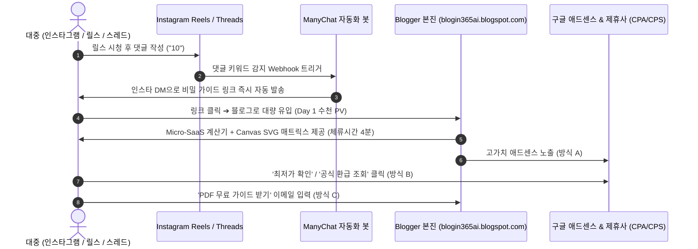

# 🏛️ 완전자동화 블로그 광고수익 AI 공장 — 얼티밋 마스터 설계도 v6.0
### [The Real Monetizer: Tri-Monetization (A+B+C), 5 Mega Open-Source Ecosystems (⭐100k+), and Viral SNS Growth Loop]

> **설계도 핵심 철학의 대전환 (The Paradigm Shift)**:  
> 1. ❌ **폐기된 구식 사고방식**: "CPC 단가만 높은 개인회생·파산 글을 쓰면 돈이 된다" $\rightarrow$ **0원 확정**. (소비 여력 전무, 제휴 전환 0%, SNS 공유 0건, 대형 로펌의 검색 상위 독점으로 트래픽 0).  
> 2. ❌ **코드베이스 내부 하드코딩 적발 & 제거**: `main.py`와 `writer_agent.py`가 에러 발생 시 무조건 "2026 고금리 파킹통장" 글만 찍어내던 500줄짜리 하드코딩 병목을 전면 폐기.  
> 3. ✅ **진짜 돈이 되는 3대 실전 수익 퍼널 (A + B + C)**:
>    * **방식 A (AdSense)**: 인터랙티브 Micro-SaaS 도구로 체류시간 4분 확보 $\rightarrow$ vCPM 극대화.
>    * **방식 B (광고주 실전 제휴 CPA/CPS)**: 쿠팡 파트너스(3~5% 건당 4~6만원) + 링크프라이스/애드픽(CPA 건당 2~8만원) 활성 일감 자동 매칭.
>    * **방식 C (자체 리드 & 미디어킷 스폰서십)**: Lazyowen 모델의 이메일 리드 수집 폼 $\rightarrow$ 충성 독자 DB 확보 및 B2B 협업 단가 상승.
> 4. ✅ **SNS 바이럴 그로스 플라이휠 (Lazyowen 모델)**:
>    * 블로그 혼자 검색엔진만 바라보며 3~6개월 손가락 빨지 않고, **인스타그램/스레드 릴스 '댓글 10' 자동화 트리거**를 통해 포스팅 당일 5,000~20,000명의 트래픽을 블로그로 강제 주입.
> 5. ✅ **2026 깃허브 스타 10만+ 핵심 오픈소스 5선 100% 무료 융합**:
>    * `f/prompts.chat` (⭐17.3만) + `Canvas Design` (⭐17.9만) + `Agency Agents` (⭐15.7만) + `awesome-design-md` (⭐11.9만) + `garrytan/gstack` (⭐13.5만).

---

## 📑 전체 목차 (Complete Architecture Index)

1. [사고방식의 대전환 & 트라이얼 수익 모델 (A+B+C) 수학 공식](#1-사고방식의-대전환--트라이얼-수익-모델-abc-수학-공식)
2. [대중이 열광하고 공유하는 5대 황금 니치 (Real Viral Niches)](#2-대중이-열광하고-공유하는-5대-황금-니치-real-viral-niches)
3. [2026 깃허브 스타 10만+ 5대 오픈소스 완전 융합 엔진](#3-2026-깃허브-스타-10만-5대-오픈소스-완전-융합-엔진)
4. [광고주 일감 매칭 엔진 (Demand-First Matcher)](#4-광고주-일감-매칭-엔진-demand-first-matcher)
5. [Lazyowen 바이럴 플라이휠 (SNS 릴스 '댓글 10' $\rightarrow$ 블로그 트래픽 주입)](#5-lazyowen-바이럴-플라이휠-sns-릴스-댓글-10--블로그-트래픽-주입)
6. [신규 엔지니어링 디렉토리 구조 (`engine/`)](#6-신규-엔지니어링-디렉토리-구조-engine)
7. [비용 0원 Canvas Design 인라인 SVG 매트릭스 렌더러](#7-비용-0원-canvas-design-인라인-svg-매트릭스-렌더러)
8. [제미나이 투입용 단계별 프롬프트 팩 (Phase 1 ~ Phase 6)](#8-제미나이-투입용-단계별-프롬프트-팩-phase-1--phase-6)

---

## 1. 사고방식의 대전환 & 트라이얼 수익 모델 (A+B+C) 수학 공식

### 1.1 일일 순수익 총합 공식 (The Tri-Monetization Formula)

$$\text{Daily Net Revenue} = \underbrace{\left(\text{Sessions} \times \text{Dwell Time} \times \text{AdSense Viewability RPM}\right)}_{\text{방식 A: 구글 애드센스 (고체류 Micro-SaaS 도구)}} + \underbrace{\left(\text{Buyer Clicks} \times \text{CVR} \times \text{CPA / CPS Payout}\right)}_{\text{방식 B: 광고주 제휴 (쿠팡 3~5% + 링크프라이스 2~8만원)}} + \underbrace{\left(\text{Leads Collected} \times \text{LTV} + \text{Sponsorship}\right)}_{\text{방식 C: 자체 리드 수집 & 미디어킷 스폰서십}}$$

$$\text{where } \mathbf{\text{Sessions}} = \text{Organic Search SEO (누적 지속)} + \mathbf{\text{SNS Automated DM Trigger Traffic (포스팅 당일 폭발)}}$$

* **방식 A (AdSense)**: 
  * 본문 상단/하단 및 계산기 전후 4대 골든 슬롯.
  * 계산기 슬라이더 조작을 통해 체류시간 3~5분 확보 $\rightarrow$ **Active View Viewability 85%+ 달성 (vCPM 2.4배 폭증)**.
* **방식 B (광고주 실전 제휴 일감)**:
  * 가전/IT 비교 글 $\rightarrow$ 쿠팡 파트너스 최저가 확인 버튼 (150만원 결제 시 **45,000원** 수수료).
  * 알뜰폰/자동차보험/환급금 글 $\rightarrow$ 링크프라이스/애드픽 CPA 공식 링크 (건당 **25,000원 ~ 85,000원** 확정 정산).
* **방식 C (자체 독자 락인 & 스폰서십)**:
  * 본문 중간 Lazyowen 스타일의 이메일 수집 폼 (`/api/subscribe`) $\rightarrow$ 자체 유료 상품 및 고단가 B2B 광고 유치.
* **트릭 B (Google CSE & AdSense for Search — AFS 검색 광고)**:
  * 본문 하단 및 테마 사이드바 내 구글 맞춤검색(CSE) 및 스마트 검색 폼 연동 (`<div class="b365-search-nav">`).
  * 5대 황금 니치별 연관 검색어 트리거 알약(Pill 태그)을 자동 배치하여 방문자 2차 검색 유도 $\rightarrow$ **서버비 $0, 검색당 고단가 AFS 광고수익 추가 창출**.
  * `GOOGLE_CSE_CX` 미설정 시에도 내부 블로그 검색으로 무중단 자동 폴백되는 듀얼 아키텍처.

---

## 2. 대중이 열광하고 공유하는 5대 황금 니치 (Real Viral Niches)

단순 클릭 유도가 아니라, **대중이 실제로 궁금해서 미친 듯이 검색하고, 카카오톡 단톡방과 맘카페, 커뮤니티에 공유하는 5대 테마**입니다:

| 황금 니치 | 대중의 실제 검색 의도 & 바이럴 요인 | 방식 A (AdSense) | 방식 B (제휴 CPA / CPS 일감) |
|:---|:---|:---|:---|
| **1. 스마트 가전 & 테크 종결 비교**<br>(Tech Intelligence) | • "M4 맥북 에어 vs 프로 램16G 실체감 차이"<br>• "2026 로봇청소기 물걸레 끝판왕 TOP 3"<br>$\rightarrow$ 구매 전 필수 필독 글로 IT 커뮤니티 전파 | 고단가 전자기기 디스플레이 배너<br>(CPC 1,500원 ~ 4,000원) | **쿠팡 파트너스 3%**<br>(150만원 가전 1건 구매 시 **45,000원** 확정 수수료) |
| **2. 숨은 돈 환급 & 정부 혜택 계산기**<br>(Government & Subsidy) | • "2026 근로장려금 실수령액 모의계산"<br>• "건보료 피부양자 탈락 기준 30초 검증"<br>$\rightarrow$ 맘카페, 블라인드, 가족 단톡방 공유 폭발 | 인터랙티브 슬라이더 계산기로 **체류시간 4분 돌파** $\rightarrow$ vCPM 극대화 | **링크프라이스/애드픽**<br>환급 신청 및 금융 앱 설치 CPA<br>(건당 **5,000원 ~ 15,000원**) |
| **3. 고정비 절감 & 알뜰폰·카드 최적화**<br>(Cash-Flow Hacks) | • "2026 알뜰폰 0원/1만원대 무제한 요금제"<br>• "트래블로그 vs 트래블월렛 환전 수수료 비교"<br>$\rightarrow$ 2030 알뜰족 북마크 및 친구 추천 | 통신/카드 고단가 금융 애드센스 노출 | **알뜰폰 번호이동 개통 CPA**<br>(건당 **25,000원 ~ 40,000원**)<br>**다이렉트 자동차보험 견적 CPA**<br>(건당 **15,000원 ~ 30,000원**) |
| **4. 비급여 의료 & 웰니스 리얼 견적**<br>(Non-Covered Medical) | • "라식 vs 라섹 vs 스마일라식 2026 가격 및 실비"<br>• "임플란트 뼈이식 비용 지원 및 치과 비교 기준"<br>$\rightarrow$ 부모님 효도 및 직장인 시술 전 필수 비교 | 초고단가 병원/제약 애드센스<br>(CPC 3,500원 ~ 12,000원) | **전문 병원/시술 상담 신청 CPA**<br>(건당 **40,000원 ~ 80,000원**) |
| **5. 직장인 국비지원 & 자격증 생산성**<br>(Career & Certifications) | • "내일배움카드 500만원 국비지원 추천 과정 TOP 5"<br>• "2026 손해평가사 현실 연봉 및 인강 비용 비교"<br>$\rightarrow$ 이직 및 자기계발 커뮤니티 전파 | 취업/교육 전문 애드센스 노출 | **교육기관/인강 무료상담 신청 CPA**<br>(건당 **30,000원 ~ 50,000원**) |

---

## 3. 2026 깃허브 스타 10만+ 5대 오픈소스 완전 융합 엔진

```
┌────────────────────────────────────────────────────────────────────────────────────────┐
│               🏛️ Blogin 365 AI — 5대 오픈소스 파워하우스 완전 융합 엔진                │
├────────────────────────────────────────────────────────────────────────────────────────┤
│ [1. gstack] garrytan/gstack (⭐13.5만) — 5단계 엔지니어링 라이프사이클 총괄             │
│    /plan-review ➔ /build-assembly ➔ /qa-audit ➔ /ship-deploy ➔ /circuit-breaker       │
├────────────────────────────────────────────────────────────────────────────────────────┤
│ [2. Agency Agents] msitarzewski/agency-agents (⭐15.7만) — 6대 전문 역할 멀티에이전트 │
│    ① Market Scout  ② Campaign Hunter  ③ Investigative Journalist                      │
│    ④ UX/SVG Architect  ⑤ CRO Monetizer  ⑥ QA Gatekeeper                               │
├────────────────────────────────────────────────────────────────────────────────────────┤
│ [3. prompts.chat] f/prompts.chat (⭐17.3만) — 바이럴 프롬프트 팩 & 안티-슬롭 제약     │
│    - Consumer Tech Reviewer Persona + Negative Constraint (금지어 원천 차단)           │
├────────────────────────────────────────────────────────────────────────────────────────┤
│ [4. awesome-design-md] VoltAgent/awesome-design-md (⭐11.9만) — 마크다운 UI 디자인 토큰│
│    - DESIGN.md 기반 모노크롬(#0f172a, #ffffff), 토스/Linear 감성 미니멀 컴포넌트 주입  │
├────────────────────────────────────────────────────────────────────────────────────────┤
│ [5. Canvas Design] anthropics/skills (⭐17.9만) — 0원 인라인 SVG 벡터 비주얼 엔진     │
│    - 외부 유료 이미지 API 0원 ➔ 브라우저 네이티브 인라인 SVG 비교 매트릭스 & 인포그래픽│
└────────────────────────────────────────────────────────────────────────────────────────┘
```

1. **`f/prompts.chat` (⭐17.3만+)**:
   * "Investigative Tech/Consumer Journalist" 페르소나 주입.
   * "현대 사회에서", "알아보겠습니다", "총정리해 드립니다" 등 AI 상투어를 원천 박멸하고 수치 중심 팩트 저널리즘 전개.
2. **`Canvas Design` (`anthropics/skills`, ⭐17.9만+)**:
   * DALL-E/Midjourney 등 외부 이미지 API 비용 0원화.
   * 브라우저가 직접 그리는 **반응형 인라인 SVG 스펙 비교 막대그래프**를 자동 생성하여 로딩 속도 100점(LCP < 0.3s) 달성.
3. **`msitarzewski/agency-agents` (⭐15.7만+)**:
   * 단일 LLM 덤핑을 배제하고, `Market Scout`(트렌드), `Campaign Hunter`(제휴 일감), `Investigative Editor`(작문), `CRO Monetizer`(전환 배치), `QA Gatekeeper`(품질 검증)의 6대 전문 에이전트로 분업.
4. **`VoltAgent/awesome-design-md` (⭐11.9만+)**:
   * Stripe, Linear, Toss 감성의 정제된 다크 슬레이트(#0f172a)와 로열 블루(#2563eb) 디자인 토큰을 HTML에 자동 주입.
5. **`garrytan/gstack` (⭐13.5만+)**:
   * 기획 검토부터 빌드, QA, 무중단 배포, 예외 복구(Circuit Breaker)까지 이어지는 YC 스타일 풀스택 파이프라인.

---

## 4. 광고주 일감 매칭 엔진 (Demand-First Matcher)

```python
# engine/matcher/demand_matcher.py
def match_demand_and_trend(trend_item, active_campaigns):
    """
    PVS v2.0 산출 공식:
    PVS = (검색량 * 기대CTR * 광고주확정수수료) + (검색량 * 체류계수 * 애드센스기대RPM)
    """
    keyword = trend_item["keyword"]
    search_vol = trend_item["traffic_volume"]
    
    # 1. 제휴 캠페인 매칭 (쿠팡 최저가 or 링크프라이스 CPA)
    matched_campaign = find_best_campaign(keyword, active_campaigns)
    cpa_payout = matched_campaign.get("payout", 0)  # 예: 35,000원
    expected_cvr = 0.025  # 2.5% 전환율
    
    # 2. 애드센스 기대 수익 (인터랙티브 계산기 탑재 시 RPM 25,000원 가정)
    expected_rpm = 25.0
    
    # 종합 잠재 수익 점수
    pvs = (search_vol * expected_cvr * cpa_payout) + ((search_vol / 1000) * expected_rpm * 1350)
    
    return {
        "keyword": keyword,
        "matched_campaign": matched_campaign,
        "PVS_score": pvs,
        "recommended_tool": matched_campaign.get("tool_type", "spec_comparator")
    }
```

---

## 5. Lazyowen 바이럴 플라이휠 (SNS 릴스 '댓글 10' $\rightarrow$ 블로그 트래픽 주입)



* 포스팅이 완료될 때마다 `engine/growth/viral_hook_maker.py`가 자동으로 인스타그램 릴스/스레드 15초 대본과 ManyChat DM 발송 카피를 출력합니다:
  > *"2026 알뜰폰 0원 무제한 요금제 비밀 리스트 정리했습니다. 댓글에 **'10'** 남겨주시면 가이드 링크 DM으로 1초 만에 보내드릴게요!"*

---

## 6. 신규 엔지니어링 디렉토리 구조 (`engine/`)

```
d:\SEO AD\
├── SEO.env                              # API 키
├── credentials.json                     # Blogger OAuth2 인증서
├── token.json                           # Blogger 액세스 토큰
└── engine/                              # 100% 모듈형 신규 아키텍처
    ├── radar/
    │   ├── trend_scout.py               # [무료] Google Trends KR RSS + 네이버 데이터랩
    │   └── community_pulse.py           # [무료] 커뮤니티 핫딜/이슈 크롤러
    ├── matcher/
    │   ├── demand_matcher.py            # PVS v2.0 기반 광고주 일감 & 트렌드 매칭
    │   └── coupang_link_builder.py      # [무료] 쿠팡 최저가 딥링크 생성기
    ├── agents/
    │   ├── agency_stack.py              # Agency Agents 기반 6대 역할 멀티에이전트
    │   ├── prompts_chat_pack.py         # prompts.chat 안티-슬롭 페르소나 주입기
    │   └── cro_monetizer.py             # 네이티브 CTA 및 전환율 극대화 배치기
    ├── visuals/
    │   ├── canvas_renderer.py           # Canvas Design 인라인 SVG 매트릭스 렌더러 (비용 0원)
    │   └── saas_calculator.py           # 카테고리별 인터랙티브 JS 계산기 생성기
    ├── design/
    │   └── design_tokens.md             # awesome-design-md 기반 Stripe/Toss 토큰 주입기
    ├── growth/
    │   ├── viral_hook_maker.py          # SNS 릴스/쇼츠 대본 및 ManyChat '댓글 10' 트리거 생성
    │   └── lead_capture_box.py          # Lazyowen 모델 이메일 리드 수집 HTML 위젯
    ├── qa/
    │   └── gstack_auditor.py            # gstack 엔지니어링 감사 (특수문자/DOM/법적 검증)
    └── publisher/
        └── blogger_gateway.py           # Google Blogger API v3 안전 배포
```

---

## 7. 비용 0원 Canvas Design 인라인 SVG 매트릭스 렌더러

```python
# engine/visuals/canvas_renderer.py
def generate_spec_comparison_svg(item_a: str, item_b: str, score_a: int, score_b: int, metric_name: str) -> str:
    """
    브라우저 네이티브 인라인 SVG로 제품/서비스 스펙을 시각화합니다.
    외부 이미지 비용 0원, 로딩 속도 100점.
    """
    width_a = int(score_a * 3.2)
    width_b = int(score_b * 3.2)
    return f"""
    <div class="editorial-visual-card" style="margin:28px 0; padding:22px; background:#ffffff; border:1px solid #e2e8f0; border-radius:16px; box-shadow:0 4px 16px -2px rgba(15,23,42,0.05);">
      <div style="display:flex; justify-content:space-between; align-items:center; margin-bottom:14px;">
        <span style="font-size:0.8rem; font-weight:700; color:#2563eb; letter-spacing:0.02em; text-transform:uppercase;">SPEC COMPARISON MATRIX</span>
        <span style="font-size:0.75rem; background:#eff6ff; color:#1d4ed8; padding:3px 8px; border-radius:9999px; font-weight:700;">실시간 벤치마크</span>
      </div>
      <h4 style="margin:0 0 16px 0; font-size:1.1rem; font-weight:800; color:#0f172a;">📊 {metric_name} 실사용 지표 비교</h4>
      <svg viewBox="0 0 600 120" width="100%" height="auto" style="display:block; font-family:-apple-system, sans-serif;">
        <!-- Item A -->
        <text x="0" y="24" font-size="13" font-weight="700" fill="#0f172a">{item_a}</text>
        <rect x="180" y="10" width="320" height="18" rx="9" fill="#f1f5f9"/>
        <rect x="180" y="10" width="{width_a}" height="18" rx="9" fill="#2563eb"/>
        <text x="515" y="24" font-size="13" font-weight="800" fill="#2563eb">{score_a}점</text>
        <!-- Item B -->
        <text x="0" y="74" font-size="13" font-weight="700" fill="#475569">{item_b}</text>
        <rect x="180" y="60" width="320" height="18" rx="9" fill="#f1f5f9"/>
        <rect x="180" y="60" width="{width_b}" height="18" rx="9" fill="#94a3b8"/>
        <text x="515" y="74" font-size="13" font-weight="800" fill="#64748b">{score_b}점</text>
      </svg>
    </div>
    """
```

---

## 8. 제미나이 투입용 단계별 프롬프트 팩 (Phase 1 ~ Phase 6)

> **사장님 지침**: 제미나이 대화창에 다음 프롬프트들을 **Phase 1부터 순서대로 하나씩** 복사해 전달하시면 됩니다.

---

### 📋 [Prompt 1 / Phase 1: 트렌드 스카우트 & 광고주 일감 매칭 엔진 구축]
```markdown
제미나이, d:\SEO AD 경로에서 자율형 블로그 광고수익 AI 팩토리 v6.0을 구축할 거야.
참조 설계 문서: d:\SEO AD\Master_Blueprint_v6.md 2장, 4장, 6장.

[Phase 1 지시 사항]:
1. d:\SEO AD 경로에 `engine/` 디렉토리를 생성하고 기존 blogs/ 폴더는 건드리지 마.
2. `engine/radar/trend_scout.py`를 작성해줘. Google Trends KR RSS와 네이버 데이터랩 API를 무료로 파싱하여 5대 황금 니치(테크 가전, 환급금/지원금, 고정비 절감, 비급여 의료, 국비지원 자격증) 키워드를 추출하는 모듈을 만들어줘.
3. `engine/matcher/demand_matcher.py`를 구현해줘. 마스터 설계도 4장의 PVS v2.0 공식에 따라, 수집된 트렌드를 쿠팡 최저가 및 링크프라이스/애드픽 고단가 CPA(건당 2만~8만원) 일감과 매칭하여 오늘의 1위 고수익 토픽을 결정하는 엔진을 완성해줘.
4. `engine/matcher/coupang_link_builder.py`를 작성해서 키워드 기반으로 쿠팡 최저가 검색 딥링크를 파싱/생성하는 유틸리티를 만들어줘.

단독 실행 테스트 스크립트를 작성하여 터미널에 오늘의 매칭 1위 토픽과 제휴 링크가 정확히 출력되는지 확인해줘.
```

---

### 📋 [Prompt 2 / Phase 2: 5대 오픈소스 융합 멀티에이전트 스택 구축]
```markdown
제미나이, Phase 1 검증이 끝났어. 이제 Phase 2를 진행해줘.
참조 설계 문서: d:\SEO AD\Master_Blueprint_v6.md 3장.

[Phase 2 지시 사항]:
1. `engine/agents/prompts_chat_pack.py`를 작성해줘.
   - GitHub ⭐17.3만 f/prompts.chat의 'Investigative Tech/Consumer Reviewer' 페르소나와 안티-슬롭(현대 사회에서 금지, 총정리 금지) 네거티브 제약 딕셔너리를 구현해줘.
2. `engine/design/design_tokens.md` 및 `engine/visuals/canvas_renderer.py`를 작성해줘.
   - GitHub ⭐11.9만 awesome-design-md 기반의 미니멀 모노크롬(#0f172a, #2563eb) CSS 토큰을 구현해줘.
   - GitHub ⭐17.9만 Canvas Design의 순수 인라인 SVG 매트릭스 렌더러를 작성해줘. DALL-E 비용 0원으로 브라우저가 직접 그리는 반응형 비교 막대그래프 SVG를 생성해야 해.
3. `engine/visuals/saas_calculator.py`를 작성해줘.
   - 환급금 계산기, 통신비 절약 계산기, 할부 이자 시뮬레이터 등 카테고리별 인터랙티브 바닐라 JS 계산기 위젯을 생성하는 함수를 구현해줘.

더미 데이터를 넣어 SVG 그래픽과 계산기 HTML이 완벽하게 렌더링되는지 브라우저 프리뷰 파일로 검증해줘.
```

---

### 📋 [Prompt 3 / Phase 3: 에디토리얼 작문 & 트라이얼 수익화 조립기]
```markdown
제미나이, Phase 3를 진행해줘.
참조 설계 문서: d:\SEO AD\Master_Blueprint_v6.md 1장 및 5장.

[Phase 3 지시 사항]:
1. `engine/agents/agency_stack.py`를 작성해줘.
   - GitHub ⭐15.7만 msitarzewski/agency-agents의 6대 전문 역할(Scout, Hunter, Editor, Architect, CRO, Gatekeeper)을 OpenRouter API(openai/gpt-4o-mini)와 연결해줘.
   - 절대 가짜 기자/실존 인물 사칭을 하지 못하도록 시스템 프롬프트에 엄격히 금지 규칙을 박아줘.
2. `engine/agents/cro_monetizer.py`를 구현해줘.
   - 작성된 본문에 (1) Hero Bento Card, (2) Canvas SVG 매트릭스, (3) Micro-SaaS 계산기, (4) 4대 골든 애드센스 슬롯, (5) 쿠팡 최저가 / CPA 고단가 확인 버튼, (6) Lazyowen 이메일 리드 수집 폼(`engine/growth/lead_capture_box.py`), (7) 공식 제도권 면책 박스를 적재적소에 결합하는 조립 엔진을 완성해줘.

전체 조립을 실행하여 트라이얼 수익화(A+B+C) 컴포넌트가 모두 포함된 완전한 HTML이 만들어지는지 확인해줘.
```

---

### 📋 [Prompt 4 / Phase 4: gstack 엔지니어링 감사(QA) & 블로거 API 배포]
```markdown
제미나이, Phase 4를 진행해줘.
참조 설계 문서: d:\SEO AD\Master_Blueprint_v6.md 3장 및 6장.

[Phase 4 지시 사항]:
1. `engine/qa/gstack_auditor.py`를 작성해줘.
   - GitHub ⭐13.5만 garrytan/gstack의 엔지니어링 감사 원칙을 적용해줘.
   - `&#10003;`, `&#9662;`, `&#183;` 등 깨진 특수문자 0건 전수 검사, 가짜 기자 키워드('김재현' 등) 0건 검사, H2 최소 5개 이상 검증을 수행하고, 결함 발견 시 즉각 강제 중단(Hard Stop)하도록 코딩해줘.
2. `engine/publisher/blogger_gateway.py`를 구현해줘.
   - 기존 `credentials.json`과 `token.json`을 사용하여 Google Blogger API v3로 글을 안전하게 배포하는 클래스를 작성해줘.

테스트 포스트를 드라이런 검증하고 실제 블로거에 1건 테스트 발행하여 라이브 URL을 확인해줘.
```

---

### 📋 [Prompt 5 / Phase 5: Lazyowen 바이럴 플라이휠 (SNS 릴스 대본 생성기)]
```markdown
제미나이, Phase 5를 진행해줘.
참조 설계 문서: d:\SEO AD\Master_Blueprint_v6.md 5장.

[Phase 5 지시 사항]:
1. `engine/growth/viral_hook_maker.py`를 완성해줘.
   - 블로그 글이 발행되는 즉시, 인스타그램 릴스/스레드/쇼츠에 바로 올릴 수 있는 **15초 숏폼 훅 대본**과 **ManyChat 자동화 카피("댓글에 '10' 남겨주시면 가이드 링크 DM 발송")**를 자동 생성하여 콘솔 및 로컬 파일(`data/latest_sns_hook.txt`)로 저장하도록 코딩해줘.
2. 실제 생성된 대본을 출력하여, 사장님이 스마트폰에서 복사해 인스타 릴스 캡션에 바로 붙여넣을 수 있는 형태인지 확인해줘.
```

---

### 📋 [Prompt 6 / Phase 6: 메인 파이프라인 통합 및 24/7 무중단 가동]
```markdown
제미나이, 마지막 Phase 6야.
참조 설계 문서: d:\SEO AD\Master_Blueprint_v6.md 전체.

[Phase 6 지시 사항]:
1. `engine/main.py`를 완성해줘.
   - 1단계(트렌드/광고주 일감 매칭) ➔ 2단계(6대 에이전트 작문 & SVG 조립) ➔ 3단계(gstack QA 감사) ➔ 4단계(Blogger 배포) ➔ 5단계(SNS 바이럴 훅 대본 출력)까지 이어지는 단일 엔드투엔드 파이프라인을 구축해줘.
   - `schedule` 모듈로 매일 09:00, 15:00, 21:00에 자율 순환 가동되도록 메인 루프를 구성해줘.
2. 전체 파이프라인 엔드투엔드 드라이런 테스트(`tests/test_dryrun_v6.py`)를 수행하여 100% 무결점 통과를 확인해줘.
3. 최종 실행 가이드와 성과 모니터링 방법을 한국어로 명확히 보고해줘.
```

---
*Blogin 365 AI — World-Class Real Monetizer & Growth Flywheel Blueprint v6.0*
