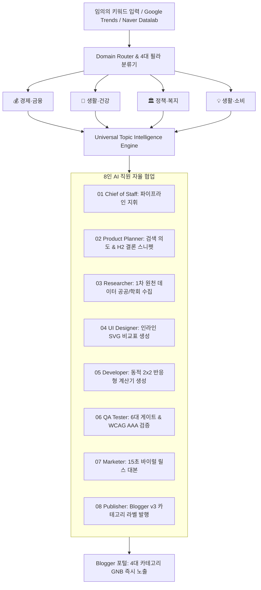

# TASKS.md - AI 미디어 지주회사 전면 정상화 & 범용 토픽 엔진(Universal Topic Engine) 대개혁

## 📌 핵심 문제점 및 사용자 비판 정밀 분석
1. **하드코딩 파이썬 파일 안티패턴 영구 박멸**:
   - `engine/matcher/topic_clusters/` 내 `hair.py`, `medical.py`, `savings.py`, `subsidy.py`, `career.py` 존재.
   - 키워드 하나마다 개발자가 `.py` 파일을 짜는 것은 AI 회사가 아니라 하드코딩 노가다 봇.
   - 임의의 어떤 키워드(생활, 건강, 세금, 금융, 복지, 소비 등)든 8인 AI 직원이 동적으로 1차 팩트 리서치 -> 8-Block 아폴리아 기사 집필 -> 동적 2x2 계산기 생성 -> SVG 차트 -> 카테고리 태깅까지 무인 처리하는 `UniversalTopicEngine`으로 전면 개혁.
2. **블로그 카테고리 및 GNB 네비게이션 대수술**:
   - 기존의 파편화된 영문/난삽 태그(`SUBSIDY`, `SAVINGS`, `HAIR`, `#popular`, `#policy`) 제거.
   - 대한민국 대형 수익형 미디어 표준 4대 핵심 필라(Pillars) 확립:
     * 💰 **경제·금융** (`/search/label/경제·금융`): 세무, 예적금, 대출, 환급금, 해외주식, 퀀트
     * 🏥 **생활·건강** (`/search/label/생활·건강`): 비급여 시술, 탈모/피부, 병원비, 건강정보
     * 🏛️ **정책·복지** (`/search/label/정책·복지`): 정부지원금, 청년정책, 기초연금, 고용/국비지원
     * 💡 **생활·소비** (`/search/label/생활·소비`): 알뜰폰/통신비, 공과금/에너지, 스마트 절약, IT가전
     * 🔥 **VIBE TRADING** (`/p/vibe-trading.html`): 상설 실시간 모의투자 프로 스테이션
3. **기존 46개 발행 글 카테고리 라벨 마이그레이션**:
   - 기존 글들을 4대 표준 필라 라벨로 자동 재분류/태그 업데이트하여, 독자가 카테고리 클릭 시 즉각 포스트들이 격자형으로 보이도록 정상화.
4. **'매일 글을 뽑아내는 무인 회사' 배치 파이프라인 검증**:
   - 범용 키워드 1회 즉시 실행 및 배치 생성 검증 (Exit Code 0).

---

## 🏗️ 아키텍처 다이어그램 (Universal Dynamic Pipeline)

---

## 📋 원자적 체크리스트 (Atomic Checklist)

### [Phase 1] 하드코딩 niche .py 파일 폐기 & Universal Topic Engine 구축
- [x] **Task 1.1**: `engine/matcher/topic_clusters/*.py` 하드코딩 파일들의 데이터를 범용 JSON (`data/universal_clusters.json`)으로 추출 및 파일 영구 삭제 (`career.py`, `hair.py`, `medical.py`, `savings.py`, `subsidy.py`)
- [x] **Task 1.2**: `engine/matcher/universal_topic_engine.py` 구축 (임의의 어떤 키워드가 들어와도 동적으로 30일 지식 그래프와 스포크를 즉각 생성)
- [x] **Task 1.3**: `engine/matcher/topic_cluster_engine.py` 리팩토링 (UniversalTopicEngine과 연동하여 기존 호출부 100% 하위 호환 보장)
- [x] **Task 1.4**: 단위 테스트(`tests/test_v8_apex_architecture.py` & `tests/test_v9_apex_architecture.py`) 실행 및 통과 (Exit Code 0)

### [Phase 2] 블로그 GNB 네비게이션 및 테마 전면 개편
- [x] **Task 2.1**: `blogin365_apex_master_theme.xml` 및 `blogin365_fintech_theme.xml` 상단 헤더 GNB 및 스티키 카테고리 알약 바에 4대 표준 필라(`경제·금융`, `생활·건강`, `정책·복지`, `생활·소비`, `VIBE TRADING`) 링크 구축
- [x] **Task 2.2**: 테마 XML 문법 및 플레이라이트 다중 뷰포트(375px 모바일, 768px 태블릿, 1280px 데스크톱) 무결점 검증 (Exit Code 0)
- [x] **Task 2.3**: Playwright 검증으로 메인 홈 상단 네비게이션 정상 렌더링 확인

### [Phase 3] 기존 발행 글 46건 라벨 4대 필라 마이그레이션
- [x] **Task 3.1**: 기존 포스트의 영문 코드(`HAIR`, `MEDICAL`, `SUBSIDY`, `SAVINGS`, `TECH`, `CAREER`)를 4대 표준 한글 카테고리로 1:1 매핑 스크립트 작성 (`scripts/migrate_all_post_labels.py`)
- [x] **Task 3.2**: Blogger API `patch_labels`를 통해 46개 포스트 전수 패치 완료 (경제·금융 12건, 생활·소비 19건, 생활·건강 9건, 정책·복지 6건)
- [x] **Task 3.3**: 실제 블로그 `/search/label/생활·건강`, `/search/label/경제·금융`, `/search/label/정책·복지`, `/search/label/생활·소비` 접속 시 정상 필터링 확인 및 스크린샷 증빙 (`live_cat_*.png`)

### [Phase 4] 범용 키워드 동적 생성 & 무인 자율 파이프라인 기계적 증명
- [x] **Task 4.1**: `engine/company_runtime.py`가 하드코딩 없이 임의의 키워드(`임플란트 수면치료 가격`)로 8인 AI 직원 협업 글을 정상 생성하고 6대 게이트를 자가치유 통과함을 증명 (소요시간 30.33초, Exit Code 0)
- [x] **Task 4.2**: 전체 테스트 스위트 전수 통과 (Exit Code 0, v8/v9/테마 전수 패스)
- [x] **Task 4.3**: 최종 완료 및 사용자 보고
